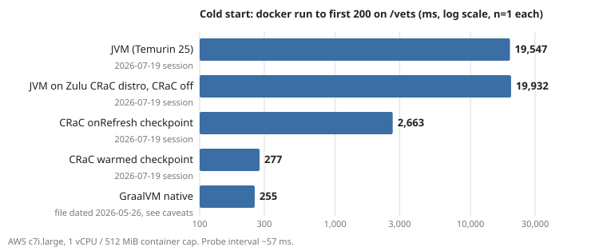

# CRaC vs GraalVM native vs JVM: Spring Boot cold start

## Question
Can a CRaC checkpoint give a Spring Boot app native-image cold start while keeping JVM throughput?

## Scenario
A Spring Boot service that scales out on load, restarts on deploy, or scales to zero pays its startup time on every new instance.
On a plain JVM that is tens of seconds of a container that takes no traffic. GraalVM native fixes startup but changes the build and
the runtime. CRaC (checkpoint/restore of a running JVM) promises the startup without leaving the JVM. For a vertical-SaaS CTO, the
question is whether CRaC is a cheaper path to fast scale-out than a native rewrite of the build, and what it costs in memory and image size.

## Setup
- App: spring-petclinic fork, Spring Boot 4.0.3, Postgres profile.
- App host: AWS EC2 c7i.large, container capped to 1 vCPU / 512 MiB. Load: EC2 c5.large with k6. DB: RDS Postgres 18.3 (db.m7i.large), same AZ.
- Images (by tag): `eclipse-temurin:25-jre`, `azul/zulu-openjdk:25-jdk-crac` (warp engine), `ghcr.io/graalvm/native-image-community:25` → `debian:bookworm-slim`.
- Warmed checkpoint: 90 s of load, then `jcmd JDK.checkpoint`, made on the target host.
- Run: 2026-07-19 (re-test 2026-07-20).
- Repo: local `spring-petclinic-crac`, branch `hq/crac-results`, commit `9b53861` (public link after Owner approval).

## Run
    python3 -I benchmark/crac/verify.py benchmark/results-crac
Local verification of all numbers from the committed raw data. A full re-run needs AWS; see `reproduce.md`.

## Results
Cold start = `docker run` to the first HTTP 200 on `/vets`, one run per variant.

| variant | cold start, ms |
|---|---:|
| JVM (Temurin 25) | 19,547 |
| JVM on Zulu CRaC distro, CRaC off | 19,932 |
| CRaC onRefresh checkpoint | 2,663 |
| CRaC warmed checkpoint | 277 |
| GraalVM native | ~255 |

Peak throughput, 512 MiB cap, median of 5 sweeps:

| variant | median RPS | p95 | p99 | fail |
|---|---:|---:|---:|---:|
| JVM (Temurin 25) | 393.8 | 2.08 s | 2.62 s | 0% |
| JVM on Zulu CRaC distro | 337.9 | 2.45 s | 3.07 s | 0% |
| CRaC warmed checkpoint | 298.6 | 2.80 s | 3.48 s | 0% |
| GraalVM native | 247.0 | 3.44 s | 4.25 s | 0% |
| CRaC onRefresh | n/a | n/a | n/a | 99.7–100% |

Memory re-test, 768 MiB cap, median of 3 sweeps: CRaC warmed 431 RPS, cold JVM on the same distro 432 RPS.
Warmed checkpoint on disk: 282.9 MB, in a 473.1 MB image (2.5x the plain JVM image).

## What it means
- A warmed CRaC restore served the first request in 277 ms vs 19.5 s on a plain JVM (~70x), level with GraalVM native.
- The restored warm heap needs memory headroom: at 512 MiB it hit the cap; at 768 MiB it matched the cold JVM's peak throughput (431 vs 432 RPS).
- An onRefresh checkpoint is a cheaper middle ground for startup (2.7 s) but starts with a cold JIT and failed the 512 MiB peak sweep.

## Limits
- n = 1 cold start per variant, probe resolution ~57 ms: CRaC (277 ms) and native (~255 ms) are a tie, not a ranking.
- Cold start was measured on a quiet host, not under load.
- At 512 MiB the warmed CRaC container failed the peak re-test at the memory cap; no OOM-kill event was logged.
- The native cold-start file comes from the May 2026 run; the July probe log gives ~256 ms.
- Absolute RPS moves ~20% between sessions; compare variants within one session only. The first sweep of each run is 10–17% lower (warmup).
- "JVM on Zulu CRaC distro" vs Temurin differs by distro and JDK vs JRE image, not by CRaC.
- One instance type, 1 vCPU containers, one app (petclinic). Images pinned by tag, not digest; JDK build string not logged.
- No cost or price/performance data.

## Changelog
- 2026-07-19/20: AWS run and memory re-test.
- 2026-11-04: numbers verified against raw data (`verify.py`); May-run JVM values replaced with July-session values.
- 2026-11-05: lab entry drafted.
