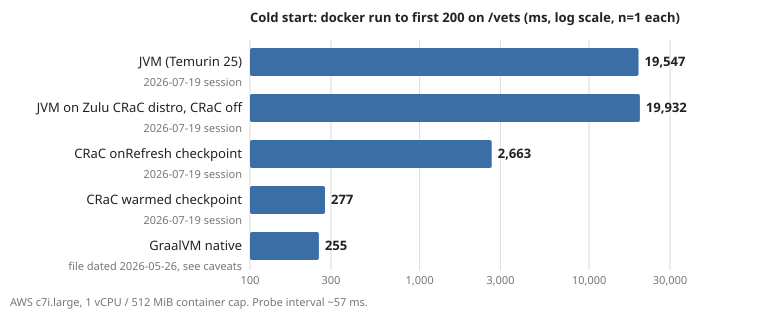

# CRaC vs GraalVM native vs JVM: cold start on AWS c7i.large

Status: draft, local only (branch `hq/crac-results`, not pushed). Verified from the raw data on 2026-11-04. No new AWS runs.

## Answer first

| variant | cold start, ms (n=1) | source run | log time |
|---|---:|---|---|
| `jvm`: Temurin 25, plain JVM | **19,547** | aws-v2-crac, 2026-07-19 | Spring `Started in` 18.3 s |
| `crac-jvm`: Zulu 25 CRaC distro, CRaC off | **19,932** | aws-v2-crac, 2026-07-19 | Spring `Started in` 17.9 s |
| `crac-onrefresh`: checkpoint at context refresh | **2,663** | aws-v2-crac, 2026-07-19 | warp restore 128 ms |
| `crac`: warmed checkpoint (`jcmd JDK.checkpoint` after 90 s of load) | **277** | aws-v2-crac, 2026-07-19 | warp restore 207 ms |
| `native`: GraalVM native image | **255** (file) / ~256 (July probe log) | aws-v2, see caveat 2 | Spring `Started in` 0.39 s (May file) |

Cold start = time from `docker run` until the first HTTP 200 on the business endpoint `/vets`, polled by `curl` every ~57 ms.

**What it means:** on 1 vCPU, restoring a warmed CRaC checkpoint starts the app in 277 ms. That is about 70x faster than the same app
on a plain JVM (19.5 s) and the same as GraalVM native (~255 ms). The 22 ms gap is smaller than one probe interval, so it is not
a real difference. The checkpoint costs memory: the restored warm heap hit the 512 MiB container cap in the 50-VU steady state and in the 512 MiB re-test.
At 512 MiB, warmed CRaC had the lowest peak throughput of the clean JVM variants (298 vs 394 RPS for Temurin JVM). It OOM-failed
the 512 MiB re-test. At 768 MiB it matched the cold JVM on the same distro (431 vs 432 RPS, median of 3). The onRefresh checkpoint
starts in 2.7 s but keeps a cold JIT, and it failed 100% of requests under the peak sweep at 512 MiB.



## Question and hypothesis

- Question: can CRaC (checkpoint/restore of a running JVM) give a Spring Boot app native-image cold start while keeping JVM peak throughput?
- Hypothesis (from the Owner's brief in `results-summary-crac.md`): a warmed checkpoint starts as fast as native and keeps warm-JIT throughput.
  An onRefresh checkpoint starts fast but runs cold.

## Method

- App: spring-petclinic fork, Spring Boot 4.0.3 (`pom.xml`), Postgres profile, Amazon RDS.
- Five variants. The Dockerfiles are in `benchmark/docker/` (`Dockerfile.jvm`, `.crac-jvm`, `.crac-warmup`, `.crac-restore`, `.crac-onrefresh`, `.native`).
- The `crac` checkpoint is made on the target c7i host against RDS (`scripts/crac-prepare-on-ec2.sh` and `scripts/make-crac-checkpoint.sh`):
  90 s of JIT warmup, then `jcmd JDK.checkpoint`. Engine: warp.
- Order per variant (`scripts/benchmark-v2.sh`): 10 min steady state with 50 VUs, then 5 back-to-back peak sweeps (k6 ramping-arrival-rate,
  100→2000 RPS), then the cold start (`scripts/app-on-ec2.sh cold_start`).
- Cold start: a background `curl` loop hits `/vets` every 50 ms plus curl time. The median gap in the logs is 56–61 ms.
  `docker run` starts 2 s after the probe begins. n = 1 per variant. No warmup or repeats apply to a cold start.
- Containers: `--memory 512m --cpus 1`, `--network host`.
- Memory: `docker stats` sampled to `*-stats-{mixed,peak}.csv`. "Cold" RSS = first sample, "peak" = max.
- Re-test (`scripts/crac-peak-retest.sh`, `results-crac/aws-crac-retest/`): `crac` and `crac-jvm` at 512m and 768m, 3 peak sweeps each.

## Environment

| item | value | source |
|---|---|---|
| app host | AWS EC2 c7i.large (2 vCPU, app capped to 1 vCPU / 512 MiB) | `terraform/variables.tf` default; summary |
| load generator | EC2 c5.large, k6 | `terraform/variables.tf` |
| database | RDS Postgres 18.3, db.m7i.large, same AZ | `terraform/v2.tf`, `variables.tf` |
| region | eu-central-1 (terraform default; the run's actual region is not recorded in the raw data) | `variables.tf` |
| OS | Ubuntu AMI (latest at apply time, not pinned) | `terraform/main.tf` |
| JVM image | `eclipse-temurin:25-jre` (tag, not digest) | `Dockerfile.jvm` |
| CRaC image | `azul/zulu-openjdk:25-jdk-crac` (tag, not digest). The summary says `Zulu25.34+17-CRaC-CA (25.0.3)`; **no raw file records this** | `Dockerfile.crac-*` |
| native build | `ghcr.io/graalvm/native-image-community:25` → `debian:bookworm-slim` (tags) | `Dockerfile.native` |
| Spring Boot | 4.0.3 | `pom.xml` |
| run dates | 2026-07-19 13:55Z (jvm) to 23:28Z (native) from probe-log epochs; re-test 2026-07-20 | `*-cold-probe.log`, gc logs |

## Numbers (all recomputed by `verify.py`; full output in `verify-output.md`)

### Peak throughput, main run (512 MiB, 5 sweeps)

| variant | median RPS | best RPS | p95 / p99 of claimed iter | fail | run dir |
|---|---:|---:|---|---:|---|
| `jvm` | 393.8 | 395.4 | 2.08 / 2.62 s | 0% | aws-v2-crac |
| `crac-jvm` | 337.9 | 340.6 | 2.45 / 3.07 s | 0% | aws-v2-crac |
| `crac` | 298.6 | 299.3 | 2.80 / 3.48 s | 0% | aws-v2-crac |
| `native` | 247.0 | 249.0 | 3.44 / 4.25 s | 0% | aws-v2 (July re-run, see caveat 2) |
| `crac-onrefresh` | n/a | n/a | n/a | 99.7–100% (3 of 5 summaries exist) | aws-v2-crac |

The first sweep is always 10–17% lower (warmup). Sweeps 2–5 vary by ≤1.2%.

### Re-test 2x2 (3 sweeps each)

| cell | per sweep RPS (fail) | median | best | peak mem |
|---|---|---:|---:|---:|
| `crac-jvm` 512m | 297, 421, 422 (0%) | 421 | 422 | 442 MiB |
| `crac-jvm` 768m | 320, 437, 432 (0%) | 432 | 437 | 507 MiB |
| `crac` 512m | 759 (60% fail), sweep 2 missing, 1050 (100% fail) | n/a | n/a | 512 MiB (cap) |
| `crac` 768m | 420, 431, 431 (0%) | 431 | 431 | 700 MiB |

### Memory, image, checkpoint (sizes are in MiB; the summary labels them "MB")

| variant | cold RSS | peak RSS (peak sweep) | max RSS (steady 50 VU) | image | checkpoint on disk | checkpoint create |
|---|---:|---:|---:|---:|---:|---:|
| `native` | 130 | 185 | 159 | 100.5 MiB (105.3 MB) | n/a | n/a |
| `jvm` | 279 | 442 | 412 | 179.7 MiB July (171.1 MiB May) | n/a | n/a |
| `crac-jvm` | 280 | 436 | 407 | 332.4 MiB | n/a | n/a |
| `crac` | 155 | 429 | **512 (cap)** | 451.2 MiB (473.1 MB) | **269.8 MiB (282.9 MB)** | 103.5 s (90 s warm + dump) |
| `crac-onrefresh` | 217 | 512 (cap) | 409 | 433.8 MiB | 210.2 MiB (220.5 MB) | 10.3 s |

Snapshot disclosure: the warmed checkpoint is 282,923,012 bytes on disk. It is baked into the restore image, which is 2.5x the July plain JVM image (179.7 MiB).
The onRefresh checkpoint is 220,450,820 bytes.

### Steady state (50 VUs, 10 min, not saturated)

jvm 352.8 RPS (p99 304 ms) · crac-jvm 348.3 (289 ms) · crac 354.2 (161 ms) · crac-onrefresh 307.4 (299 ms) · native 304.2 (p50 57 ms, p99 199 ms). All with 0% fail.
The load is VU-bound, so these numbers say nothing about capacity.

## Check of `results-summary-crac.md` against the raw data

| claim | raw | verdict |
|---|---|---|
| jvm cold 19,366 ms | `aws-v2/jvm-cold-start-ms.txt` = 19366, file dated **2026-05-26** (earlier rig run). The July session file `aws-v2-crac/jvm-cold-start-ms.txt` = **19,547**. `aws-v2/jvm-cold-probe.log` is the July log (identical to aws-v2-crac) and gives 19,548, not 19,366 | **MISMATCH (provenance).** The summary mixes a May number into the July table. Use 19,547 |
| jvm "Started 14.4 s" | `aws-v2/jvm-spring-started-s.txt` 14.438 (2026-05-27). July = 18.266 | **MISMATCH (provenance).** Use 18.3 s |
| crac-jvm 19,932 / Started 17.9 s | aws-v2-crac 19932 / 17.925 | OK |
| crac warmed 277 ms / restore 207 | aws-v2-crac 277 / 207; probe log 278 | OK |
| crac-onrefresh 2,663 / restore 128 | aws-v2-crac 2663 / 128; probe 2664 | OK |
| native 255 ms / Started 0.39 s | `aws-v2/native-cold-start-ms.txt` 255 and spring-started 0.389, both dated **May 2026**. The July native probe log (2026-07-19 23:28Z) gives ~257−1 ≈ 256 ms. The July ms file was not saved | **OK in value, provenance mixed.** Same result either way |
| "~70x" | 19,547/277 = 70.6; 19,366/277 = 69.9 | OK |
| peak jvm 394 / crac-jvm 340 / crac 298 / native 247 "best of 5" | best = 395.4 / 340.6 / 299.3 / 249.0; median = 393.8 / 337.9 / 298.6 / 247.0 | **Label wrong, values ≤1% off.** They are neither the best nor consistently the median. Say "median of 5" |
| variance "±1–2%" | sweeps 2–5 within 1.2%; sweep 1 is 10–17% low | OK only if sweep 1 is excluded; say so |
| re-test crac-jvm 512m 421 | median 421.3 | OK |
| re-test crac-jvm 768m 435 | sweeps 320.5 / 437.0 / 432.4. 435 = mean of sweeps 2–3 | **MISMATCH.** Median 432, best 437 |
| re-test crac 768m 427 | sweeps 420.1 / 431.2 / 430.6. 427 = mean of all 3 (includes warmup sweep) | **MISMATCH.** Median 431. Conclusion unchanged: crac 431 vs crac-jvm 432 (−0.3%) |
| re-test peak RSS 442 / 506 / 511 / 699 MB | 442 / 507 / 512 / 700 MiB | OK (rounding; units are MiB) |
| crac 512m "OOM under load" | 60% then 100% failures, memory at the cap, sweep 2 summary missing. **No OOM-kill event is recorded** (no dmesg, no `OOMKilled`, the gc log ends normally) | Inferred, not logged. Say "failed at the memory cap" |
| cold RSS 130/279/280/154/217, peak 185/442/436/428/511 | 130/279/280/155/217, 185/442/436/429/512 MiB | OK (±1 rounding) |
| image 100/171/332/451/433, checkpoint 269/210 | 100.5 / 171.1 (May) or 179.7 (July) / 332.4 / 451.2 / 433.8, checkpoint 269.8 / 210.2 MiB | OK in MiB, truncated not rounded. jvm image is May (July = 179.7) |
| checkpoint create 103.5 s / 10.3 s | 103.5 / 10.3 | OK |
| steady 300–354 RPS, crac p99 161 ms, native p50 57 ms | 304.2–354.2, 161.0, 57.0 | OK |
| not mentioned in summary | `crac` reached the **512 MiB cap during the 50-VU steady state** too (max 512 MiB) | Add as a caveat |
| Zulu25.34+17-CRaC-CA (25.0.3) | no raw file records the JDK build | Unverified. The image tag floats |
| "cold-start-under-load" | `app-on-ec2.sh cold_start` runs **only the curl probe**, no k6 load (`benchmark-v2.sh` Phase C) | **Label wrong.** It is a quiet-host cold start |

## Caveats

1. **n = 1 per cold start.** No medians exist. The resolution is about 57 ms (probe interval), so crac 277 ≈ native 255 is a tie.
   A real cold-start distribution needs about 10 repeats per variant.
2. **Mixed sessions in `aws-v2/`.** It merges runs from 2026-05-26/27, 2026-06-07/09 and 2026-07-19/20. The file mtimes and the
   epoch timestamps inside the probe logs show which is which. `SOURCE-MTIMES.txt` lists all of them. Native in `aws-v2-crac/` failed
   (100% errors), so native was re-run on 2026-07-19 ~23:28Z. That run's peak, steady and stats files are in `aws-v2/`, but its
   cold-start ms file is not (the 255 ms file is from May).
3. Absolute peak RPS moves about 20% between sessions (crac-jvm 340 main vs 421 re-test; jvm 474 in May vs 394 in July).
   Compare variants only within one session.
4. The JDK and base images are pinned by tag, not by digest, and the JDK build version is not logged. An exact re-build is not guaranteed.
5. `crac-jvm` vs `jvm` differ by distro (Zulu vs Temurin) and by image (JDK vs JRE): 340 vs 394 RPS. That is not a CRaC effect.
6. Raw data under `benchmark/results/` is gitignored in the source repo and lives only in the Owner's working copy.
   This branch commits a curated copy (`benchmark/results-crac/`, 760 KB, every file sha256-listed in `SOURCE-MANIFEST.sha256`).
   The k6 per-request CSVs, gc logs and k6 stdout (~1.5 GB) are not committed. Their hashes are in the manifest.
7. The summary prints 12-hex prefixes of the sha256 of the real and placeholder API secrets. A low-entropy secret could be brute-forced
   from them. Drop them before publishing.

## What may be claimed

- On a c7i.large with the container capped to 1 vCPU / 512 MiB, a warmed CRaC restore served the first business request 277 ms after `docker run`.
  A plain Temurin 25 JVM took 19.5 s (~70x). GraalVM native took ~255 ms, the same within the measurement resolution. Single run each.
- An onRefresh checkpoint starts in 2.7 s, 7x faster than the JVM, and runs with a cold JIT.
- The warmed checkpoint image adds 283 MB (270 MiB) of checkpoint to a 473 MB (451 MiB) image. That is 2.5x the plain JVM image and 4.5x native.
- At 768 MiB, warmed CRaC peak throughput equals cold JVM on the same distro (431 vs 432 RPS median, 3 sweeps, one session).
- The restored warm heap needs headroom. At 512 MiB the warmed CRaC container hit the cap and failed under the peak re-test.

## What must NOT be claimed

- "CRaC is faster than native" or the reverse: 22 ms apart, n = 1, 57 ms resolution.
- "Cold start under load": there was no load during the cold-start phase.
- 19,366 ms or 14.4 s as July-session JVM numbers. They come from the May run.
- "Best of 5" for the peak table. "±1–2% variance" without "excluding the first warmup sweep".
- "OOM-killed" as an observed event. Say "failed at the 512 MiB cap" unless an OOMKilled record is found.
- Any statement about other instance types, multi-core containers, or apps other than petclinic.
- The Zulu build string, unless it is re-checked in the image (`docker run azul/zulu-openjdk:25-jdk-crac java -version` resolves to today's tag, not July's).
- Cost or price/performance. No cost data was recorded for this run.

## Reproduce

Checking the numbers costs nothing and needs no AWS:

```bash
git clone <this repo> && cd spring-petclinic && git checkout hq/crac-results
python3 -I benchmark/crac/verify.py benchmark/results-crac > /tmp/v.md && diff /tmp/v.md benchmark/crac/verify-output.md
python3 -I benchmark/crac/make_chart.py benchmark/results-crac /tmp/cold-start.svg   # chart
```

(`verify.py` needs Python 3 and the `zstd` binary. Run against the Owner's full `benchmark/results/`, it also lists the extra aws-v2
files that are not in the curated copy.)

Full re-run on AWS. **This costs money:** about 10 h of EC2 c7i.large + c5.large + RDS db.m7i.large on-demand, judging by the
2026-07-19 timestamps (13:55Z → 23:28Z), plus ECR and S3. The price was not computed here. It needs Owner approval.

```bash
AWS_PROFILE=<your-aws-profile> VARIANTS="jvm crac-jvm crac crac-onrefresh native" ./benchmark/scripts/benchmark-v2.sh
./benchmark/scripts/crac-peak-retest.sh        # 2x2 memory re-test
```

Local-only variant (no AWS, not comparable to the numbers above): `benchmark/scripts/make-crac-checkpoint.sh` makes a warmed checkpoint
against a throwaway Postgres on the local box (needs a kernel with `CONFIG_CHECKPOINT_RESTORE`). `benchmark/scripts/run-local.sh` runs
the jvm/native rig. The only local CRaC output that exists is `results/local-crac-preview` (build and checkpoint times only, no cold start).

## Raw data

- Committed copy: `benchmark/results-crac/` (aws-v2-crac, aws-crac-retest, and the jvm/native subset of aws-v2 and aws-v2-peak).
- Source (not in git): `~/git/patotski/spring-petclinic/benchmark/results/{aws-v2-crac,aws-v2,aws-v2-peak,aws-crac-retest}`.
  The sha256 manifest of all 554 source files is in `benchmark/results-crac/SOURCE-MANIFEST.sha256`.
- Verification output: `benchmark/crac/verify-output.md`.
